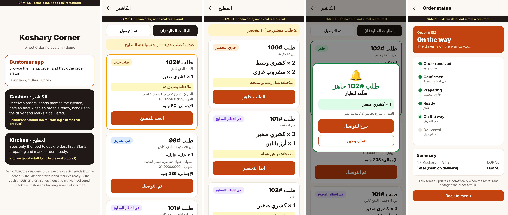

# Koshary Order — Restaurant Ordering App (Sample)

> **Label: Sample** — built for my Freelance Graduation Project (case MOB-02). Koshary Corner is a fictional client from the course case; the menu, prices and orders are demo data. Not a real restaurant and not client work.

A clickable sample of the key screens for a restaurant that wants customers to order **directly** (instead of through delivery aggregator apps) and wants staff to update order status from a simple Arabic screen.



## Screens

| # | Screen | What it shows |
|---|---|---|
| 1 | Menu | Categories, item cards with Arabic names, add/remove quantity, sticky cart bar |
| 2 | Cart & checkout | Quantities, subtotal + delivery fee, name / Egyptian mobile / address validation, kitchen note, cash on delivery |
| 3 | Order status | 4-step tracker (Received → Preparing → On the way → Delivered) that updates live |
| 4 | Staff screen (Arabic, RTL) | Current vs delivered orders, "new order" alert, one big button per order to move it to the next status |

**Try the flow:** add items → place an order → tap *Open staff screen* → press **ابدأ التحضير** → go back: the customer's status has changed to *Preparing*.

## Design decisions (linked to the client's problem)

- **Staff screen in Arabic with one big action button per order** — the staff are not tech-savvy, so each order needs only one tap per step.
- **Cash on delivery first** — online payment is a Phase 2 option, keeping the MVP inside the budget.
- **Order status is a must-have** — it is what separates a real ordering system from a WhatsApp menu.
- **One React Native codebase** runs on Android, iOS and the web, so the same work can be compared as an app or as a PWA.

## What this sample does NOT include

No back-end: cart and orders live in memory on one device (React Context + `useReducer`). In a real build, orders would be stored in a back-end (e.g. Firebase or Supabase) so the customer's phone and the staff tablet see the same data in real time. Also not included: login, push notifications, payments, menu admin.

## Tech

React Native 0.86 · Expo 57 · Expo Router · TypeScript · React Context

## Run it

```bash
npm install
npx expo start
```

Open in Expo Go, an emulator, or press `w` for the web.

---
Built by Muhammed Sherif · Mobile developer (React Native)
